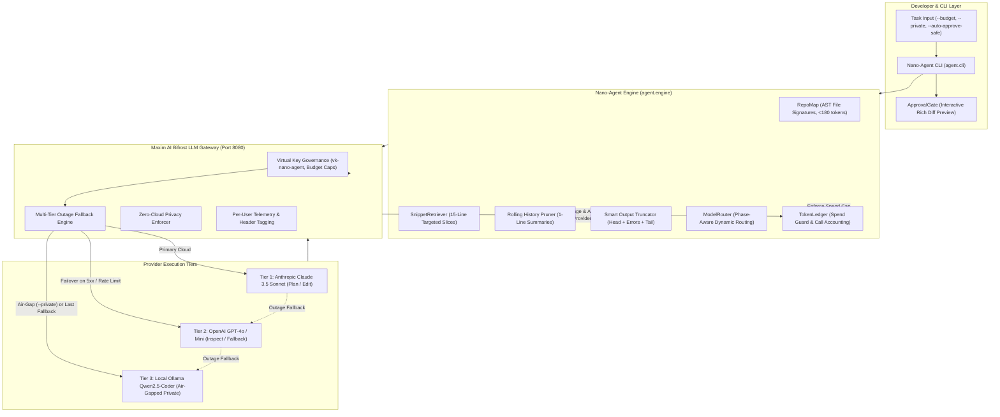

# Nano-Agent ⚡
### Hyper-Token-Thrifty CLI Coding Agent with Maxim AI Bifrost Gateway & Zero-Cloud Privacy Mode

Nano-Agent is an ultra-lightweight CLI coding agent written in Python, designed from first principles to solve real-world software engineering tasks while consuming **up to 86.4% fewer tokens and 89.9% lower cost** than conventional coding agents. Nano-Agent routes all LLM calls through **Maxim AI's Bifrost Gateway**, providing resilient multi-provider failover, virtual key budget limits, per-user usage telemetry, and an air-gapped local privacy mode.

---

## 🎯 Problem Statement

Traditional AI coding assistants (e.g., standard ReAct agents, IDE copilots, and full-context agents) suffer from five critical flaws:

1. **Massive Context Bloat & Cost Explosion**:
   - Standard agents dump entire 500-line source files into the prompt repeatedly across every turn.
   - Initial context often consumes 4,500–10,000+ tokens before the agent has written a single character of code.
   - For multi-turn tasks, conversation history grows quadratically ($O(N^2)$), rapidly exhausting token allowances and driving costs upwards of \$0.10–\$0.50 per small fix.

2. **Single-Point-of-Failure Provider Outages**:
   - Most agents lock into a single cloud provider (e.g., Anthropic or OpenAI). If that provider returns an HTTP 500, 503, or 429 rate limit mid-task, the session crashes, throwing away all accumulated progress.

3. **Runaway Spend & Lack of Budget Controls**:
   - Autonomous tool-calling loops can enter infinite recursion when encountering tough bugs, silently burning through developer credits with no hard spending ceiling.

4. **Confidentiality Leaks on Proprietary Code**:
   - Enterprise and regulated codebases cannot legally transmit intellectual property to cloud LLM APIs. Standard agents lack a strict, air-gapped local execution boundary that guarantees zero cloud data egress.

5. **Destructive Whole-File Rewrites**:
   - Inexperienced agents rewrite entire files to change 2 lines, burning hundreds of completion tokens per turn and risking catastrophic code hallucinations.

---

## 💡 The Nano-Agent Solution

Nano-Agent eliminates these challenges by pairing an ultra-lean context compression engine with **Maxim AI's Bifrost Gateway**:

- **-86.4% Token Reduction & -89.9% Cost Reduction**: Ingests Python AST code skeletons, targeted 15-line snippet slices, search/replace diff blocks, and rolling history pruning.
- **Outage Resilience via Bifrost Fallback Chain**: Primary Cloud (`Claude 3.5 Sonnet`) $\to$ Secondary Cloud (`GPT-4o`) $\to$ Local Ollama (`Qwen2.5-Coder`), with automatic failover and answering-provider telemetry.
- **Hard Spend Guardrail (`--budget`)**: Proactively halts the agent before or upon reaching user-defined spend caps (e.g., `--budget 0.50`), preventing runaway costs.
- **Air-Gapped Privacy Mode (`--private`)**: Automatically purges all cloud models from the routing table and enforces 100% on-device Ollama inference with an active defense guardrail blocking cloud dispatches.
- **Human-in-the-Loop Diff Gate**: Mandatory colored unified diff previews and interactive confirmation (`[y/N]`) before any file write, shell command, or git operation (with `--auto-approve-safe` for read-only actions).

---

## 🏗️ Architecture Diagram



---

## ⚡ How Maxim AI Bifrost Powers Nano-Agent

Nano-Agent delegates all upstream LLM orchestration, resilience, and gateway governance to **Maxim AI's Bifrost**:

1. **Unified OpenAI Client Interface**:
   Nano-Agent uses standard `openai.OpenAI(base_url="http://localhost:8080/v1")` to talk seamlessly to Anthropic, OpenAI, and Ollama without vendor-specific SDK lock-in.

2. **Multi-Provider Fallback Routing**:
   Bifrost's `governance.routing_rules` and fallback chain ensure that if Anthropic API throws an outage or 429 rate limit, the gateway seamlessly fails over to OpenAI or local Ollama, logging the answering provider.

3. **Virtual Key Governance & Budget Caps**:
   Configured with virtual key `vk-nano-agent` in `bifrost/config.json`, enforcing monthly spending budgets (`max_limit: 5.0`) directly at the proxy layer.

4. **Per-User Telemetry & Auditing**:
   Every request forwards `x-bifrost-user`, `x-user-id`, and `x-client: nano-agent` headers, allowing organizations to monitor per-developer token consumption and latency metrics in Bifrost.

5. **Air-Gapped Privacy Boundary**:
   In `--private` mode, Bifrost isolates the routing table to `http://localhost:11434`, ensuring zero outbound cloud traffic.

---

## 📦 Installation & Setup

### 1. Prerequisites
- **Python**: 3.10, 3.11, 3.12, 3.13, or 3.14
- **Node.js**: 18+ (required to run `@maximhq/bifrost` via npx)
- **Ollama** *(Optional, for local private mode)*: [ollama.com](https://ollama.com) with `qwen2.5-coder:7b`

### 2. Clone & Install Dependencies
Nano-Agent has strictly **three external Python dependencies** (`openai`, `rich`, `pytest`):

```bash
git clone https://github.com/your-username/nano-agent.git
cd nano-agent

# Create virtual environment
python -m venv venv
source venv/bin/activate  # On Windows: venv\Scripts\activate

# Install minimal dependencies
pip install -e .
```

### 3. Environment Configuration
Copy `.env.example` to `.env` and fill in your placeholders:

```bash
cp .env.example .env
```

```ini
# Upstream Provider Keys (Routed through Bifrost)
OPENAI_API_KEY=sk-proj-your-openai-key
ANTHROPIC_API_KEY=sk-ant-your-anthropic-key
OLLAMA_BASE_URL=http://localhost:11434

# Bifrost Gateway Settings
BIFROST_BASE_URL=http://localhost:8080/v1
BIFROST_API_KEY=sk-bf-nano-agent-secret-key
BIFROST_ENCRYPTION_KEY=0123456789abcdef0123456789abcdef
AGENT_USER_ID=hackathon-dev-1
AGENT_BUDGET_CAP=1.00
```

### 4. Start Bifrost Gateway
Launch Bifrost locally using the pre-configured schema:

```bash
# On Linux / macOS:
./run_bifrost.sh

# On Windows PowerShell:
.\run_bifrost.ps1
```

Verify Bifrost connectivity:
```bash
python test_bifrost.py
```

---

## 🚀 Usage Guide

### 1. Standard Coding Task (Cloud with Bifrost Outage Fallback)
```bash
python -m agent.cli "Fix bug in pricing.py where percentage discount is subtracted directly"
```

### 2. Enforcing a Hard Spending Budget
Set a safety ceiling in USD; the agent automatically trips a circuit breaker and stops before runaway spend occurs:
```bash
python -m agent.cli "Refactor authentication middleware" --budget 0.50
```

### 3. Air-Gapped Private Mode (Local Ollama Only)
Confidential repository mode. Strictly purges all cloud providers; never transmits code to the cloud:
```bash
python -m agent.cli "Audit cryptographic keys and token validation in auth.py" --private
```

### 4. Safe Auto-Approval Mode
Auto-approves read-only actions (`read_file`, `search_repo`, `git status`), but still prompts interactively for file edits, terminal commands, and commits:
```bash
python -m agent.cli "Inspect repository structure and suggest performance fixes" --auto-approve-safe
```

### 5. Headless / Scripting Mode
Bypasses interactive approval prompts for CI/CD pipelines:
```bash
python -m agent.cli "Run test suite and fix failing tests" --auto-approve
```

---

## 🎬 Screen Recording Demos

Three turnkey demonstration scripts are included for hackathon video submissions and live presentations:

```bash
# Launch interactive menu (choose 1, 2, 3, or all)
python run_demos.py

# Demo 1: Multi-Provider Outage Failover (Claude 503 -> GPT-4o failover)
python demo_outage.py

# Demo 2: Budget Guardrail (Tiny $0.0020 cap -> Agent proactively halts)
python demo_budget.py

# Demo 3: Air-Gapped Privacy Mode (--private with cloud network blocked)
python demo_privacy.py
```
> See [DEMOS.md](DEMOS.md) for full scene-by-scene narrative scripts, visual cues, and voiceover talking points.

---

## 📊 Empirical Benchmarks: -86.4% Token Reduction

Nano-Agent was empirically benchmarked against a **naive full-context baseline** (full file dumps, full file rewrites, unpruned history) across **6 real-world software engineering tasks** in a sample repository:

| # | Task Name | Category | Naive Tokens | Naive Cost | Naive Result | Nano Tokens | Nano Cost | Nano Result | Token Reduction | Cost Reduction |
| :-: | :--- | :--- | :---: | :---: | :---: | :---: | :---: | :---: | :---: | :---: |
| 1 | **Fix Percentage Discount Calculation** | Bug Fix | 6,041 | \$0.0200 | ✅ PASS | 816 | \$0.0020 | ✅ PASS | **-86.5%** | **-89.9%** |
| 2 | **Add Currency Formatter Helper** | Feature Addition | 6,052 | \$0.0202 | ✅ PASS | 809 | \$0.0020 | ✅ PASS | **-86.6%** | **-90.0%** |
| 3 | **Write Unit Test for Expired Token** | Write Unit Test | 6,016 | \$0.0198 | ✅ PASS | 838 | \$0.0021 | ✅ PASS | **-86.1%** | **-89.4%** |
| 4 | **Fix ZeroDivisionError in Restock Rate** | Bug Fix | 5,959 | \$0.0193 | ✅ PASS | 803 | \$0.0020 | ✅ PASS | **-86.5%** | **-89.7%** |
| 5 | **Refactor Duplicate Email Validation** | Refactoring | 6,184 | \$0.0213 | ✅ PASS | 872 | \$0.0022 | ✅ PASS | **-85.9%** | **-89.7%** |
| 6 | **Implement Top Customers Analytics Query** | Feature Addition | 6,164 | \$0.0211 | ✅ PASS | 811 | \$0.0020 | ✅ PASS | **-86.8%** | **-90.5%** |
| **ALL** | **TOTAL / AVERAGE** | **6 Tasks** | **36,416** | **\$0.1218** | **6/6 PASS** | **4,949** | **\$0.0123** | **6/6 PASS** | **-86.4%** | **-89.9%** |

Run the automated benchmark suite yourself:
```bash
python run_benchmark.py
```
> See [BENCHMARKS.md](BENCHMARKS.md) for full task-by-task descriptions, code diffs, and verification logs.

---

## 🛠️ Implementation Notes: The 6 Token Optimization Techniques

1. **RepoMap AST Signatures vs. Full File Dumps (-96% Initial Context)**:
   - Uses Python's native `ast` parser to extract only class declarations, method names, and line numbers (`get_file_skeleton`).
   - Replaces multi-thousand-token whole-file ingestion with a concise `<180 token` signature map.

2. **Targeted Snippet Retrieval (`SnippetRetriever`) (-85% Read Tokens)**:
   - Instead of reading entire files, searches for target symbols and extracts narrow 15-line slices with 1-based line numbers.

3. **Block Search/Replace (`edit_file`) vs. Full File Rewriting (-80% Completion Tokens)**:
   - Instead of forcing the model to rewrite whole files (150–300 completion tokens per turn), Nano-Agent takes exact `search_block` and `replace_block` pairs (30–60 completion tokens).

4. **Smart Output Truncation (`truncate_tool_output`)**:
   - Pytest output logs often dump 50–200 lines. Nano-Agent preserves the initialization head (5 lines), failure/error/traceback lines, and the summary tail (8 lines) while omitting non-critical passing lines.

5. **Rolling History Summarization & Pruning**:
   - Compresses turns older than 4 iterations into single-line confirmation notes, eliminating quadratic $O(N^2)$ context accumulation.

6. **Dynamic Model Routing (`ModelRouter`)**:
   - Informs Bifrost of the preferred model tier: routes cheap inspection/summarization turns to `gpt-4o-mini` (\$0.15/1M in) and reserves strong planning/editing models (`claude-3-5-sonnet`) strictly for code modifications.

---

## 💻 Technologies Used

- **Maxim AI Bifrost Gateway**: Unified routing, virtual keys, budget caps, multi-provider failover, telemetry.
- **Python 3.10+**: Core engine, AST parsing, difflib, subprocesses.
- **OpenAI Python SDK (`openai>=1.0.0`)**: Standardized gateway interface client.
- **Rich (`rich>=13.0.0`)**: Terminal diff previews, call ledger tables, status badges, progress panels.
- **Pytest (`pytest>=8.0.0`)**: Verification test suite and benchmark validation harness.
- **Ollama**: Local air-gapped LLM inference backend for `qwen2.5-coder:7b`.

---

## 🧪 Verification & Test Suite

Run the complete 38-test pytest suite:
```bash
pytest tests/ -v
```

All 38 tests pass with 0 warnings:
- `test_approval.py`: Unified diff generation, interactive approvals, denials, `--auto-approve-safe`.
- `test_budget.py`: Model pricing calculations, `TokenLedger` tracking, budget cap enforcement.
- `test_context.py`: AST repo maps, snippet slices, output truncation, history summarization.
- `test_gateway.py`: Bifrost fallback chain, answering provider logging, provider outage recovery.
- `test_privacy.py`: Sanitized effective chain, cloud dispatch blocking, loud local outage failure.
- `test_router.py`: Phase-aware dynamic model routing.
- `test_tools.py`: Search/replace block edits, tool execution, safety gates.
- `test_engine.py`: End-to-end task loop, pre-call budget checks, private mode fail-loud logic.

---

## 📄 License

MIT License. Built for the **Maxim AI Bifrost Hackathon**.
